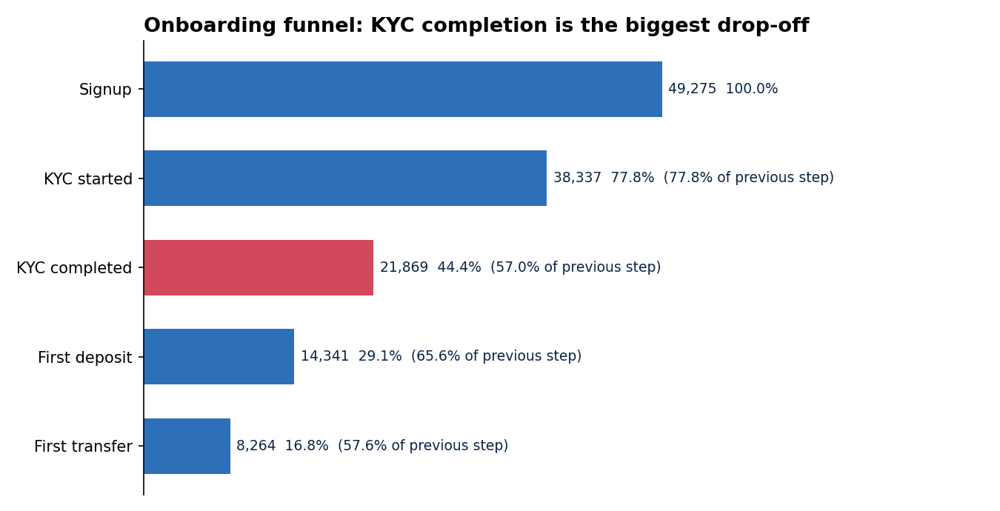
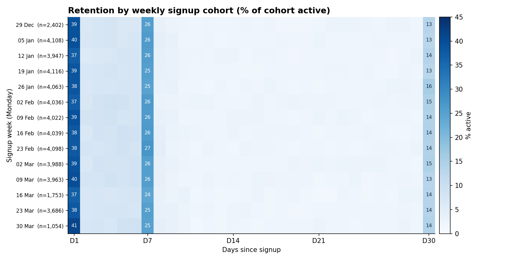
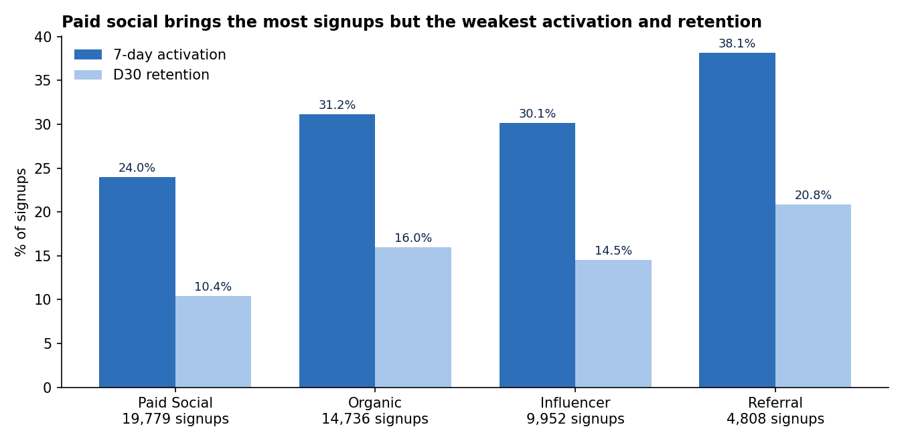
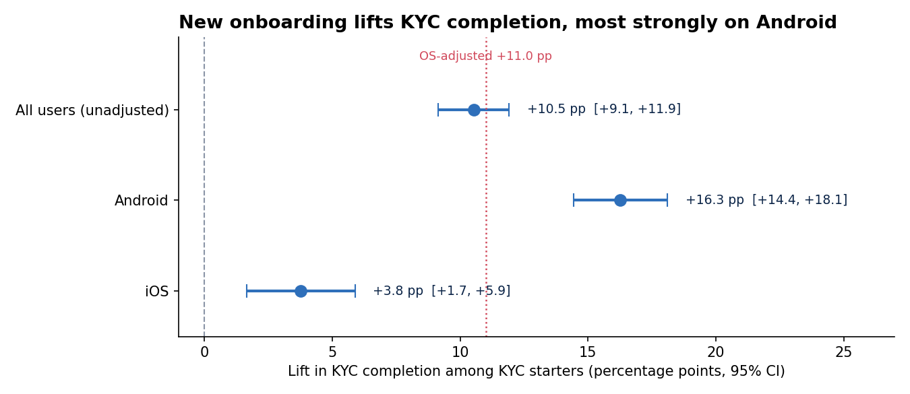

# Onboarding Funnel, Retention & A/B Test Analysis for a Mobile Savings App

**Where do new users drop off, and did the redesigned onboarding fix it?** An end-to-end product analytics project using SQL and Python, on a synthetic dataset modelled on a Nigerian fintech savings app.

> **Note on data:** The dataset is synthetic (generated with a seeded Python script) because real fintech data is not publicly available. Patterns were planted deliberately and the analysis was done blind to them. Findings describe this dataset, not a real company.

---

## 1. Title
**Onboarding Funnel, Retention & A/B Test Analysis for a Mobile Savings App**
*Author: Gideon Sunday · SQL · Python · Product Analytics*

## 2. Executive Summary
Out of 49,275 real signups, fewer than half (44.4%) finish identity verification (KYC), and only 29.1% add money to their wallet. KYC is where the app loses the most people: about 16,500 users start it and never finish. Android users struggle the most, with 53.6% completing KYC compared with 63.1% on iOS.
The team tested a redesigned onboarding flow, and it worked. It raised KYC completion by about 11 percentage points (taking into account that the two test groups had different Android and iOS mixes), and the result is statistically solid (p < 0.001), so it is very unlikely to be chance. It also raised the share of users who fund their wallet within 7 days by 4.8 percentage points. The biggest improvement was on Android, at +16.3 points.
**Recommendation: ship the new onboarding to all users, starting with Android.** Separately, paid social supplies 40% of signups but has the weakest activation (24.0%) and 30-day retention (10.4%), against 38.1% and 20.8% for referral.

## 3. Business Problem
**Stakeholder:** Head of Product at a mobile savings and wallet app.

**Pain:** Most people who sign up never fund their wallet, so acquisition spend is wasted, and many who do fund it stop using the app within a month.

**Decisions to inform:**
1. Where in onboarding are users lost, and for which segments?
2. Did the redesigned onboarding (`onboarding_v2`) improve KYC completion and activation, and should it be shipped?
3. Which acquisition channels bring users who actually activate and stay?

## 4. Methodology

**Data (synthetic, 4 tables):** `users` (50,000), `events` (335,329), `transactions` (39,344), `experiment_assignments` (24,486). Signups run 1 Jan to 31 Mar 2026; events run to end of May so D30 retention is observable for everyone. The data includes realistic mess: duplicate events, missing values, test accounts and out-of-order timestamps.

**Pipeline**

| Step | Tool | What was done and why |
|---|---|---|
| 1. Load | MySQL | Schema with keys and indexes; row counts checked against the source files |
| 2. Clean | MySQL views | Excluded 725 test accounts; removed 3,320 duplicate events with `ROW_NUMBER()`; flagged 599 users with KYC completed before KYC started; built a one-row-per-user milestone view |
| 3. Funnel | MySQL | Step and cumulative conversion overall and by channel, device OS and signup week. Counting is "ever reached the step", so timestamp errors don't distort it |
| 4. Retention | MySQL | Active = app open or successful transaction. D1/D7/D30 retention and 7-day activation by channel, OS, cohort week |
| 5. A/B test | Python | Sample ratio check, covariate balance, pre-treatment check, two-proportion z-test with CIs, OS-stratified and logistic-regression estimates, power analysis |
| 6. Visuals | Python | Funnel, retention heatmap, uplift chart, channel chart |

**Key analytical decisions**
- BVN submission is treated as a diagnostic, not a funnel stage: 1,088 users complete KYC without a BVN event, and completion is about 57% either way.
- The primary A/B metric is KYC completion among users who started KYC, because that is the step the redesign changes. Activation and retention are secondary.
- The experiment arms have unequal OS mix, so the OS-adjusted estimate is reported alongside the raw one.

**Repo structure**
```
├── data/        synthetic CSVs (UTC timestamps)
├── sql/         01_schema_and_load, 02_clean_views, 03_funnel, 04_retention
├── python/      00_export_from_mysql.sh, 05_ab_test.py, 06_visuals.py
├── images/      charts used below
├── docs/        project_log.md (step-by-step reasoning), ab_test_output.txt
└── requirements.txt
```

**Reproduce:** (1) run `sql/01_schema_and_load.sql`, then `02` to `04`; (2) `bash python/00_export_from_mysql.sh <user>`; (3) `pip install -r requirements.txt`, then `cd exports && python ../python/05_ab_test.py && python ../python/06_visuals.py`.

## 5. Skills
- **SQL (MySQL 8.0):** CTEs, window functions (`ROW_NUMBER`, `LAG`, `FIRST_VALUE`), conditional aggregation, views, self-joins, date arithmetic, data-quality auditing
- **Python:** pandas, NumPy, SciPy, statsmodels (z-tests, confidence intervals, logistic regression, power analysis), matplotlib
- **Analytics:** funnel analysis, cohort retention, activation metrics, experiment design and validation (sample ratio and balance checks), Simpson's paradox and mix-shift adjustment, communicating a ship / no-ship recommendation

## 6. Results & Business Recommendation

### Funnel


| Step | Users | Step conversion | Cumulative |
|---|---|---|---|
| Signup | 49,275 | n/a | 100% |
| KYC started | 38,337 | 77.8% | 77.8% |
| **KYC completed** | **21,869** | **57.0%** | **44.4%** |
| First deposit | 14,341 | 65.6% | 29.1% |
| First transfer | 8,264 | 57.6% | 16.8% |

- Android completes KYC at 53.6% vs iOS 63.1%, and Android is 64% of signups.
- All channels look identical through KYC and diverge afterwards, at the KYC-to-deposit step.

### Retention and channel quality



Overall retention: D1 38.5%, D7 25.8%, D30 13.9%. Retention is stable across weekly cohorts and equal on Android and iOS.

| Channel | Signups | 7-day activation | D30 retention |
|---|---|---|---|
| Referral | 4,808 | 38.1% | 20.8% |
| Organic | 14,736 | 31.2% | 15.9% |
| Influencer | 9,952 | 30.1% | 14.5% |
| Paid social | 19,779 | 24.0% | 10.4% |

### A/B test: new onboarding vs control


| Metric | Control | Treatment | Lift |
|---|---|---|---|
| KYC completion (KYC starters) | 55.3% | 65.8% | +10.5 pp (OS-adjusted +11.0 pp) |
| ... Android | 49.7% | 66.0% | +16.3 pp |
| ... iOS | 61.7% | 65.5% | +3.8 pp |
| Signup to first deposit | 28.4% | 33.3% | +4.9 pp |
| 7-day activation | 28.0% | 32.8% | +4.8 pp |
| D30 retention | 14.3% | 14.1% | no change (p = 0.74) |

Treatment wins inside both OS groups and the effect differs by OS (interaction p < 0.001). The sample split passed (p = 0.58) and the step before the redesign did not change, but Android was over-represented in treatment (61.6% vs 54.3%), so the OS-adjusted figure is the one to rely on.

### Recommendation
1. **Ship `onboarding_v2` to all users, Android first.** Expected impact: about +4.8 pp activation, roughly 480 more activated users per 10,000 signups.
2. **Review paid social on cost per activated user, not cost per signup.** It is 40% of volume but activates and retains users at roughly half the rate of referral. This dataset has no spend data, so the budget decision needs cost figures.
3. **Invest in referral.** It has the smallest volume and the best activation and retention.
4. **Monitor retention after rollout.** More users activated but D30 retention did not rise, so check that the extra activated users retain as well as the rest.

### Limitations
- Data is synthetic. Activity clusters on D1, D7 and D30 with little between, which real products do not show, and results will be cleaner than real data.
- Randomisation was unbalanced on device OS, which a real experiment would treat as a bug to fix.
- No cost data, so channel conclusions are about quality, not ROI.
- The first-transfer / retention link is correlational: transfers count as activity and engaged users transfer more.

## 7. Next Steps
- Re-run the test with randomisation stratified by device OS and a pre-registered sample size.
- Compare retention of users activated by v2 vs control to confirm the extra users stick.
- Add cost data and calculate cost per activated user and payback by channel.
- Break down the KYC step (BVN entry, document upload, selfie) to find exactly where Android users stall.
- Add guardrail metrics for rollout: KYC failure rate, fraud flags and support tickets.
- Build a dashboard (Power BI, Tableau or Looker Studio) for the funnel and channel views.
- Validate the approach on real or public data.
